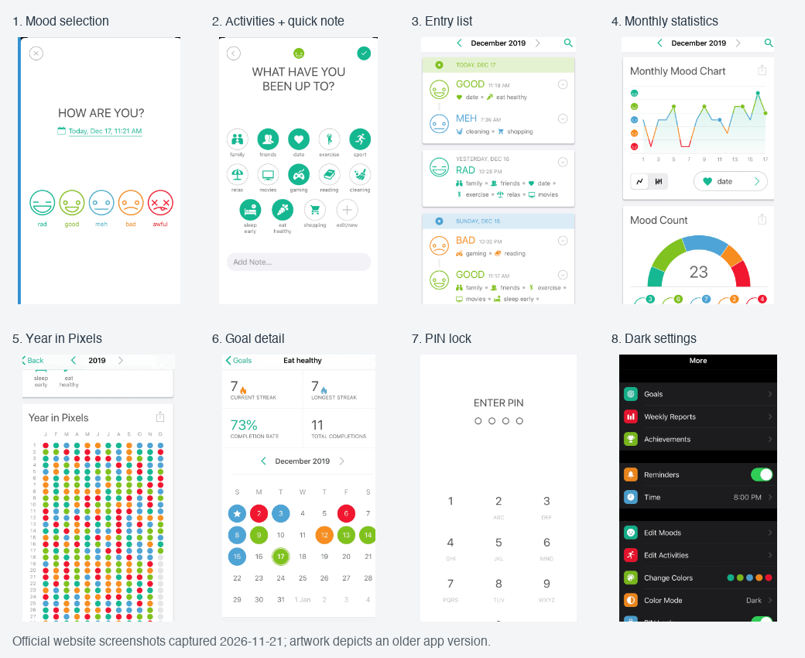

# Daylio 公开资料与界面研究

调研日期：2026-11-21。用途：作为记得日记的比较样本，与国内日记产品及其他产品一起评估，不预设 Daylio 为主导设计。此次只读调研，没有修改产品源码或部署。

Daylio 最可借鉴的是低负担的“选心情 → 选活动 → 可选文字/照片”记录路径，以及同一套心情色贯穿列表、图表和年度像素的语义一致性。它偏重情绪与行为追踪，不能直接等同于长文日记的最佳编辑与阅读结构。

## 证据范围与可信度

- **视觉已见**：实际打开官网并查看、截取八个 App 演示界面：心情、活动、条目列表、统计、年度像素、目标、PIN、深色设置。下方联系表由这些浏览器截图裁切组合，未重绘 App 界面。
- **官方文字**：实际阅读十五篇官方 FAQ/教程；正文、链接、图片地址与页面截图保存在 `daylio/`。多数帮助页显示 2024 年更新，目标帮助页显示 2025-09-09 更新。
- **关键时效限制**：官网 App 演示图资源地址含 `/2020/04/`，画面内日期为 2019-12。它们是官方历史展示，**不能当作 2026 最新版本实测截图**。FAQ 中部分 S3 教程图片未成功加载，因此未声称看见这些图里的当前编辑器和配色选择器。
- **未做**：没有安装移动 App、登录、购买 Premium、进入付费页面或测量原生动画帧率。未直接看到当前完整日历页、提醒编辑页、备份操作页、全文编辑器与全部付费主题；这些仅在官方文字有证据时列出。

## 按页面拆解

| 页面/功能 | 已看到的界面或官方证据 | 层级与交互结论 | 对记得日记的参考及边界 |
|---|---|---|---|
| 心情录入 | **视觉已见**：白底、居中问句、可点日期时间、一排五个轮廓表情；从青绿、黄绿、蓝到橙、红。**官方文字**：五个基础分类，可改名字、表情、颜色；自定义心情挂在五个基础分类下，点该类三个点再展开。[S1][S2] | 主任务非常明确，首次只呈现五个选项；低频自定义藏到二级。官方明确建议不要太早加过多心情，否则记录表单复杂。 | 借鉴先简后繁、日期可修正、语义色稳定。自定义分类必须保持统计归属。不要强制长文用户必须先做问卷。 |
| 活动/标签录入 | **视觉已见**：顶部返回/完成；分行圆形图标网格，选中为实色底白图标，未选中为细描边；标签在图标下；底部浅灰 Quick Note 入口。[S1] | 主选择为多选，完成动作稳定置顶；活动图标与文字并用。 | 可参考标签/人物选择和完成反馈；记得日记现有图片/地点/人物并不等同于 Daylio 活动，需独立定义关系。 |
| 文字编辑/模板 | **官方文字**：活动和目标下方、照片上方有 Note；Quick Note 与 Full Note；全文支持粗体、斜体、列表；可选现成模板，也可在 More → Writing Templates 自建。**未看到当前全文编辑器**。[S3] | 短记录入口轻，长写作是可扩展路径；模板不是强制步骤。 | 借鉴编辑入口分层、模板填入后可继续写。工具栏、键盘位置和富文本手势仍需另找当前视觉证据。 |
| 日记列表/搜索 | **视觉已见**：月份导航+搜索；按日分组白卡，日期带淡心情色背景；同日多条记录在组内；左边大表情、右边心情名/时刻/活动小图标。**官方文字**：列表和日历两种浏览，可搜索。[S1] | 第一层是日期，第二层是心情，第三层活动，文字密度低于一般长文日记。 | 可借鉴日期组、筛选入口、同日归组与清晰元信息；不建议把长篇正文压到次要层。 |
| 日历 | **官方文字**确认日历视图；**视觉已见的是目标详情中的月历**，不是当前日记月历。[S1][S5] | 目标月历用彩色日点标记完成/情绪，当前日期有轮廓强调。 | 只能作为“点选日期+状态图例”样本；普通日历的页切换、同日多条呈现、空白日期交互待补证据。 |
| 统计总览 | **视觉已见**：白色图表卡，月度心情折线沿语义色变化；图表右上分享图标；下方半圆环展示 Mood Count；顶部月份与左右导航。[S1] | 每张卡只回答一个统计问题，同一套心情色跨图保持一致。 | 可参考单卡单问题、时间范围明确、图例一致；图表总数需以用户真实需求收敛，避免首页堆满看板。 |
| 心情/活动详情统计 | **官方文字**：从 Stats 点击一个心情或活动深入 Frequency、Influence on Mood、Longest Period、Mood Count、Related Activities、Occurrence During Week；支持区间比较，并给 Low/Medium/High confidence。[S6] | 从概览到细节；关联计算区分“记录有无该活动/前一天/同天/后一天”，而非一句因果断言。 | 可借鉴样本量和可信度说明。不能把相关性写成“活动导致心情变化”，数据不足时应有解释型空态。 |
| 年度像素 | **视觉已见**：12列月份×日期行的小圆点，完整一年一张图，语义色对应心情，空白日灰色；右上分享。[S1] | 很高信息密度但视觉语法简单，色彩本身是数据。 | 借鉴紧凑年度概览和导出；必须有图例、色盲替代/文本说明，不能仅用颜色传意。 |
| 目标列表/目标详情 | **视觉已见**历史目标详情：当前/最长连续天数、完成率、累计次数四块指标，再放月历。**2025官方文字**：More → Goals；目标可来自挑战或已有活动，日/周重复可自定义；Entries顶部也展示目标；无需写日记也可勾选；活动与目标联动；已完成项目置底。[S5] | 完成动作在经常访问的位置，设置在详情下层；归档可恢复，删除丢失目标统计，并明确与原活动的关系。 | 可参考目标状态和日记状态分开、完成后降低占位；不应把“字数达标”变成用户写日记的阻力。 |
| 图片/相册 | **官方文字**：每条最多9张；活动页滚到底 Photo，能拍摄/图库选择；More → Photo Gallery；图片查看可 Show Entry 回到原日记；删除图片从日记编辑做。[S4] | 图片与原条目关系明确，查看与破坏性编辑分开。 | 可参考相册→来源日记的回路。9张限制不是记得日记必须照搬的设计。 |
| 设置/主题/深色 | **视觉已见**：深色 More 为纯黑页面、深灰分组行；左侧彩色方形图标+白字+右箭头；提醒开关和时间独立行；Edit Moods/Edit Activities/Change Colors/Color Mode 分开。Change Colors 行预览五个色点。[S1] **官方文字**：预设配色+自定义颜色、表情风格。[S2] | 内容语义色与浅/深色背景分离；主题入口能在一行预览当前值。 | 可参考预览与分组；应验证整体视觉、心情语义、阅读字体分别可配置，避免每个设置都改变全局结构。 |
| 字体/可读性 | **官方文字**：主要建议使用操作系统字号、显示缩放、高对比度、色彩校正；Android 帮助明确当时不具备通用字号支持。[S10] | 不能据此声称 Daylio 已覆盖所有大字体场景。 | 记得日记应自行验中文字体、字号、长标签、320px和系统缩放，不照搬此限制。 |
| 提醒 | **视觉已见**历史 More 中提醒开关与“8:00 PM”时间行；**官方文字**：目标提醒可设时间和自定义文字，Premium 列出 Infinite Reminders。[S1][S5][S9] | 常用开关直接在设置行，复杂计划进入二级。 | 提醒权限、实际触发、静音/时区/重复状态仍要单独验证；未观察完整设置过程。 |
| 备份/恢复 | **官方文字**：Android Google Drive，iOS iCloud；More → Backup and Restore；成功后 toast+最近备份日期更新；自动备份每次记录后执行，失败重试、多次失败通知并建议手动备份；可手动导出 Backup File，含条目、心情、活动、设置。[S7][S8] | “成功时间”是持久反馈，toast是瞬时反馈；失败有重试路径；导出备份和阅读导出不同。 | 必须以真实落盘/上传结果更新状态。国内可用性要另选存储方案，不能直接照搬Google服务。 |
| 导出 | **官方文字**：PDF/CSV；PDF可选最近7/30天、上周/月、全部，可含心情活动汇总；官方提示大批量含图导出可能耗尽内存，可选较短区间或不含照片。[S1][S11] | 导出有范围和内容选项，利用系统分享。 | 可参考预估范围、进度、失败恢复；不能把内容下载等同于可恢复备份。 |
| PIN/生物识别 | **视觉已见**：独立白底PIN页，四个密码圆点，大间距数字键盘；**官方文字**：PIN/指纹/Face ID；忘码建议生物识别或已有备份恢复；无备份官方也不能取回。[S1][S14] | 隐私入口与日记页面隔离，恢复能力边界明确。 | 要测试深链刷新、防闪、后台锁定、键盘/读屏不可触达底层；只盖一层遮罩不构成完整访问隔离。 |
| 多端/后端边界 | **官方文字**：日记本地存储，不上传Daylio服务器；可自有云备份；建议单主设备，非同时多设备实时同步，不开发Web/Desktop。[S12][S13][S15] | Daylio的隐私架构简化了账号层，但不同于实时同步产品。 | 记得日记有Web部署，不能把Daylio的“备份”描述成“多端实时同步”；后端能力和产品文案须一致。 |

## 字体、颜色、结构与动效

**视觉观察**：App演示图采用接近系统无衬线的字体，正文常规、导航/统计标题适度加重；字形精确名称无法从位图确认。官网自身圆润标题字体属于营销页，不能直接当App字体依据。App以白/浅灰或黑/深灰作为容器，中等圆角、细分隔；大色块蓝/红/绿主要是官网演示背景，**不是App页面背景**。

| 颜色用途 | 观察值 | 来源与限制 |
|---|---|---|
| 官网品牌强调 | `#15B790` | 官网 DOM computed style 实际值，仅确认官网品牌。 |
| 官网文字 | `#4D6274` | 官网 DOM computed style 实际值，不当作App正文token。 |
| App浅背景/卡片 | 约 `#F2F2F7` / `#FFFFFF` | 从已看到的官方历史列表截图采样，缩放/抗锯齿可能有差异。 |
| App深背景/分组 | 约 `#000000` / `#1C1C1E` | 从官方历史深色设置截图采样；不是当前源码值。 |
| 心情五色 | 约青绿 `#16B892`、黄绿 `#80C21F`、蓝 `#4EA4D6`、橙 `#F78C1F`、红 `#F11731` | 从统计截图内部色块采样。只用来理解色相/语义，不能直接复制为可访问设计token。 |

**交互已证实的层级**：轻量首次录入 → 可选补充内容 → 完成；概览 → 指定心情/活动详情；设置行 → 专项配置。**未证实的动效**：静态官网截图无法证明 App 的过渡时长、弹簧参数、手势响应、滚动帧率或无障碍减弱动画支持。本次不把“看起来简洁”写成“实测丝滑”。

## 付费边界与未覆盖项

官方 Premium 帮助列出：iOS PIN锁、进阶统计、更多心情/图标、自定义模板、无限提醒、自动备份、PDF导出、额外/自定义配色、无限目标及Important Days。[S9] 官网总体功能介绍没有逐项免费/付费标签，因此不能从官网截图推导所有功能免费，也未验证当前套餐、价格、试用页面。

没有证据覆盖当前每一个App页面。仍缺：当前完整长文编辑器、日历记录详情、提醒编辑、备份冲突/失败界面、所有主题配置页、订阅页、中文本地化完整体验、无数据/加载/断网/错误状态、真实触屏动效与原生性能。这些应在选定参考方向后通过官方当前演示或授权实机继续核实。

## 等待与国内样本比较的设计候选

1. 心情语义色独立于品牌强调色；日期、标签、图表使用同一映射，任何皮肤下都保持可读性。
2. 记录主流程应短：新建、写入、保存/草稿反馈。心情、标签、人物、媒体按需展开，不让次要配置打断写作。
3. 设置以分组行+当前值预览保持秩序。是否采用纸感衬线、系统黑体、极简或彩色情绪风格，等国内样本与用户偏好共同决定。
4. 统计从少量核心问题开始，复杂关联进入详情，并说明数据范围、样本量、空态与可信度。
5. 备份、导出和同步分别说清楚，成功状态可追溯，恢复流程实测；国内网络条件是选择方案的一部分。

以上为研究候选，不是已决定或已实施的改版方案。

## 官方来源与本地证据

- [S1 官网、公开产品演示](https://daylio.net/)；本地 `daylio/official-home.json`、`home-details.json`、`feature-1.png` 至 `feature-8.png`。
- [S2 心情创建/管理/颜色](https://daylio.net/faq/docs/daylio-faq/tutorials/create-and-manage-moods/)。
- [S3 Quick/Full Note、模板](https://daylio.net/faq/docs/daylio-faq/tutorials/add-note-to-entry/)。
- [S4 图片与Photo Gallery](https://daylio.net/faq/docs/daylio-faq/tutorials/adding-and-managing-photos/)。
- [S5 目标创建与统计](https://daylio.net/faq/docs/daylio-faq/tutorials/setting-up-goals/)。
- [S6 活动/心情详细统计](https://daylio.net/faq/docs/daylio-faq/about/activity-and-mood-statistics/)。
- [S7 备份方式](https://daylio.net/faq/docs/daylio-faq/backup/backup-options/)。
- [S8 备份成功与失败重试](https://daylio.net/faq/docs/daylio-faq/backup/are-my-data-backed-up/)。
- [S9 Premium 功能边界](https://daylio.net/faq/docs/daylio-faq/about/daylio-premium-features/)。
- [S10 字号与高对比度](https://daylio.net/faq/docs/daylio-faq/tutorials/how-to-change-font-size-and-contrast/)。
- [S11 PDF导出](https://daylio.net/faq/docs/daylio-faq/tutorials/pdf-export/)。
- [S12 不开发电脑/Web版的官方说明](https://daylio.net/faq/docs/daylio-faq/tutorials/writing-entries-on-computer/)。
- [S13 多设备使用限制](https://daylio.net/faq/docs/daylio-faq/tutorials/using-multiple-devices/)。
- [S14 忘记PIN](https://daylio.net/faq/docs/daylio-faq/issues/forgotten-pin-code/)。
- [S15 数据存储与隐私](https://daylio.net/faq/docs/daylio-faq/about/how-secure-is-my-data/)。

所有页面均于本次通过浏览器打开。每个帮助页的 `.json` 保存提取正文/链接，`help-*.png` 保存页面截图；研究中引用官方宣传与安全陈述代表官方立场，不等于独立安全审计。
